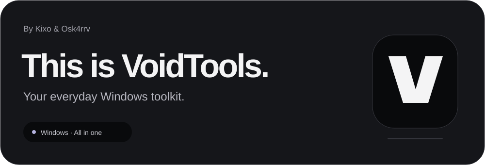
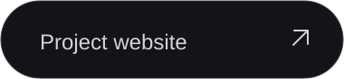
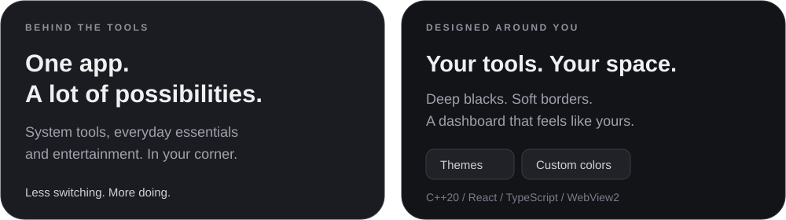
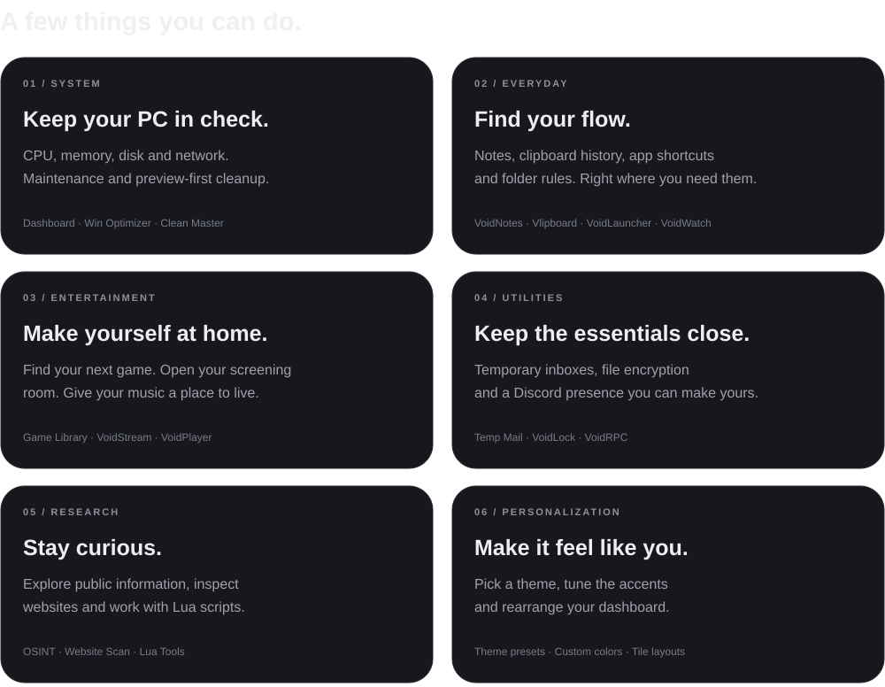
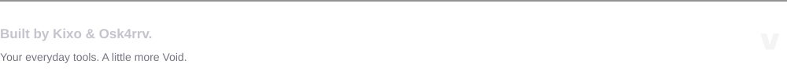

  

  &nbsp;
  

  

## The toolkit

  

See the [module guide](https://voidtools.software/explore/) and [project overview](https://voidtools.software/about/). Feature availability depends on your account and app version.

  

